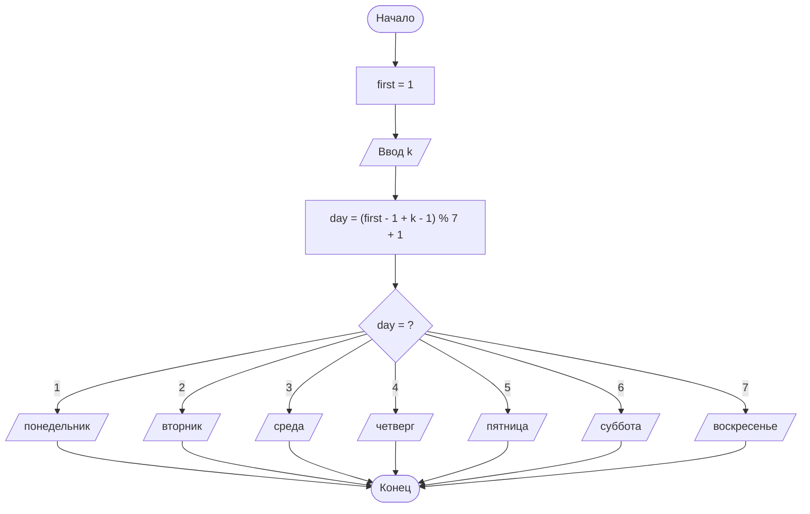

# Задание 6. День недели

## Условие задачи

Дано целое число k. Определить, каким днём недели является k-й день невисокосного
года, в котором 1 января приходится на заданный заранее день недели.

---

## 1. Идея решения

Дни недели нумеруем числами от 1 до 7:

| Номер | 1 | 2 | 3 | 4 | 5 | 6 | 7 |
|---|---|---|---|---|---|---|---|
| День | понедельник | вторник | среда | четверг | пятница | суббота | воскресенье |

День недели 1 января задан заранее — переменная `first` (в программе `first = 1`,
то есть 1 января — понедельник; для другого дня достаточно изменить это число).

Недели повторяются каждые 7 дней, поэтому от 1 января до k-го дня проходит `k - 1` дней
и день недели сдвигается на `(k - 1) % 7` относительно `first`. Чтобы результат остался
в диапазоне от 1 до 7, нумерацию временно сдвигаем к диапазону 0..6:

```
day = (first - 1 + k - 1) % 7 + 1
```

Проверка: при k = 1 получаем `day = first`, при k = 8 (ровно через неделю) день недели
тот же, что и при k = 1.

Год невисокосный, поэтому в нём 365 дней: k должно быть в диапазоне от 1 до 365.
Заметим, что 365 = 52 · 7 + 1, поэтому 365-й день года (31 декабря) приходится на тот же
день недели, что и 1 января.

---

## 2. Алгоритм и блок-схема

### Алгоритм

1. Объявить переменные типа `int`: `k` (номер дня года), `first` (день недели 1 января, 1 — понедельник), `day` (искомый день недели).
2. Запросить и считать число `k`.
3. Вычислить день недели: `day = (first - 1 + k - 1) % 7 + 1`.
4. С помощью оператора `switch` вывести название дня недели по номеру `day`.
5. Завершить программу.

### Блок-схема



---

## 3. Реализация программы

Исходный код находится в файле [weekday.c](weekday.c).

---

## 4. Результаты работы программы

Считаем, что 1 января — понедельник (`first = 1`).

Пример 1 — k = 1:

```
Введите номер дня года k (1 - 365): 1
1-й день года - понедельник
```

Пример 2 — k = 7:

```
Введите номер дня года k (1 - 365): 7
7-й день года - воскресенье
```

Пример 3 — k = 100: (1 − 1 + 100 − 1) % 7 + 1 = 99 % 7 + 1 = 1 + 1 = 2:

```
Введите номер дня года k (1 - 365): 100
100-й день года - вторник
```

Пример 4 — k = 365:

```
Введите номер дня года k (1 - 365): 365
365-й день года - понедельник
```

---

## 5. Информация о разработчике

- **ФИО:** Воротников Дмитрий Романович
- **Группа:** бОТИ-261
